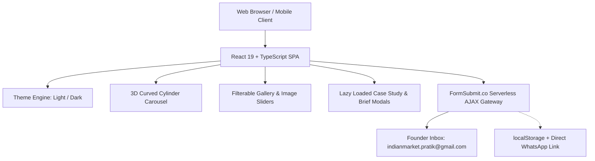

# 🇮🇳 Indian Market Events & Promotion — Enterprise Web Portal

> **"Turning Ideas into Impact"** — Experiential Marketing, Brand Activation & Pan-India Event Production.  
> Official corporate digital platform for **Indian Market Events & Promotion** (Est. 2018 | Nashik, Maharashtra).  
> 🌐 **Live Production Website:** [https://indianmarketevents.com](https://indianmarketevents.com)

---

## 📌 Table of Contents
- [Executive Overview](#-executive-overview)
- [Key Features & User Experience](#-key-features--user-experience)
- [Flagship Campaigns & Case Studies](#-flagship-campaigns--case-studies)
- [System Architecture & Technology Stack](#-system-architecture--technology-stack)
- [Directory Structure](#-directory-structure)
- [Local Development & Setup](#-local-development--setup)
- [Serverless Form & Email Handling](#-serverless-form--email-handling)
- [Deployment Guide](#-deployment-guide)
- [Company Profile & Contact Information](#-company-profile--contact-information)

---

## 🌟 Executive Overview

**Indian Market Events & Promotion** is a premier, full-service event management and experiential marketing agency founded in 2018 by **Pratik Medhane** (Founder & Event Director), headquartered in Nashik, Maharashtra. With 8+ years of proven operational excellence, the agency specializes in:

- **Brand Activations & Retail Roadshows**
- **Pan-India Corporate Conclaves & Tech Summits**
- **Public Health & Nationwide CSR Initiatives**
- **Intellectual Properties (IPs) & Cultural Festivals**
- **School & College Outreach Programs (SCP)**
- **Turnkey Production & On-Ground Manpower Deployments**

This repository houses the modern, ultra-responsive single-page application (SPA) designed to showcase the agency’s extensive portfolio, client credentials, geographical reach across Tier 1, 2, and 3 cities, and to facilitate immediate project brief acquisition from corporate clients.

---

## 🚀 Key Features & User Experience

### 1. 🎡 Proprietary 3D Cylinder Curved Card Carousel
- **Physics-Driven Motion:** Custom 3D cylindrical projection (`perspective`, `rotateY`, `translateZ`) offering tactile drag, inertia momentum, velocity tracking, and touch swipe gestures.
- **Auto-Cycling Multi-Image Previews:** Cards featuring multi-angle campaign photography cycle automatically every 2.8 seconds with subtle crossfade transitions.
- **Visual Pagination & Badges:** Features live counter badges (`1/6`, `1/8`, etc.), active pagination dots, and direct click-to-expand triggers into full case-study modals.
- **Arc Curvature Geometry:** Uses SVG clip paths to recreate realistic curved cinema screen cards.

### 2. 🗂️ Interactive Filterable Portfolio Grid
- Filter through categories: **All**, **Corporate**, **CSR Initiatives**, **Intellectual Properties (IPs)**, **School Contact Programs**, and **Competitions**.
- Built with `CardImageSlider.tsx` for seamless hover-to-slide or auto-cycling photo inspection.

### 3. 🏛️ Held Programs Directory (20+ Enterprise Events)
- Comprehensive record of marquee events delivered across India.
- High-contrast brand logo containers for partner identification (HDFC Bank, Sun Pharma, HP, The Times of India, Maharashtra Times, Maharashtra Arogya Vibhag, Castrol, etc.).
- Detailed case study modals detailing Client Objectives, Challenges Faced, Execution Strategy, and Measurable Outcomes.

### 4. 🌗 Dual Theme Engine (Dark / Light Mode)
- Built on a semantic CSS variable system (`var(--bg-dark)`, `var(--card-bg)`, `var(--text-primary)`, `var(--accent-orange)`).
- Persistent state management with instant toggle, responsive SVG logo adaptation, and zero flash of unstyled content (FOUC).

### 5. ⚡ Code-Splitting & Optimized Performance
- Heavy modals (`BriefModal.tsx` and `ProjectDetailModal.tsx`) are code-split using `React.lazy()` and `Suspense`, keeping initial JS bundle sizes lean (~349 KB) and achieving lightning-fast First Contentful Paint (FCP).

---

## 🏆 Flagship Campaigns & Case Studies

| Campaign | Partner / Client | Format & Location | Highlights |
| :--- | :--- | :--- | :--- |
| **पाडवा पहाट (Padwa Pahat)** | HDFC Bank & Maharashtra Times | Traditional Morning Concert (Jalgaon) | Grand Diwali morning classical musical celebration; over 1,500+ attendees, full artist management, sound & stage fabrication. |
| **कर्करोग जनजागृती कार्यक्रम** | सार्वजनिक आरोग्य विभाग (महाराष्ट्र शासन) & The Times of India | Healthcare Conclave (Multi-City) | Large-scale cancer awareness & training drive for ASHA healthcare workers; auditorium staging, audio-visuals, and protocol coordination. |
| **CALS CPR Lifesaving Initiative** | Sun Pharma & SATS Academy | On-Ground Public Health Drive (Multi-City) | Hands-on CPR & resuscitation training using certified medical mannequins across public parks and high-footfall venues. |
| **HP miniTEK Conference** | HP India | Corporate Tech Showcase | Next-generation workstation expo, executive keynote setup, interactive demo booths, and VIP delegate hospitality. |
| **MT Helpline** | Maharashtra Times | Educational Career Conclave | Guidance & counseling conclaves connecting thousands of students with leading academic experts. |

---

## 🛠️ System Architecture & Technology Stack



- **Frontend Core:** [React 19](https://react.dev/) + [TypeScript](https://www.typescriptlang.org/)
- **Build Tool:** [Vite 8](https://vitejs.dev/) with Rolldown Engine & Lightning Fast HMR
- **Icons:** [Lucide React](https://lucide.dev/) (Modern tree-shakeable SVG icon set)
- **Styling:** Modular CSS3 with Custom Variables, Flexbox, CSS Grid, and 3D Transforms
- **Forms & Email:** 100% Serverless AJAX via [FormSubmit.co](https://formsubmit.co)
- **Deployment Targets:** Vercel, Netlify, Cloudflare Pages, GitHub Pages

---

## 📁 Directory Structure

```text
Indian Market/
├── public/                     # Static production assets
│   ├── _redirects              # Netlify SPA routing fallback
│   ├── logos/                  # High-res client & institutional brand logos
│   │   ├── hdfc.png
│   │   ├── arogya.png
│   │   ├── sunpharma.png
│   │   ├── hp.png
│   │   └── ...
│   └── photos/                 # Campaign & event documentation photography
│       ├── padwa1.jpeg - padwa6.jpeg
│       ├── cancer1.jpeg - cancer8.jpeg
│       ├── cpr1.jpeg - cpr4.jpeg
│       ├── hp1.jpeg - hp4.jpeg
│       └── ...
├── src/
│   ├── assets/                 # Vector assets, default agency logos (dark/light)
│   ├── components/             # Reusable UI component library
│   │   ├── Navbar.tsx          # Glassmorphic floating nav with mobile drawer
│   │   ├── HeroSection.tsx     # Cinematic hero section with high-impact CTAs
│   │   ├── CurvedCardCarousel.tsx # 3D cylindrical drag-and-swipe carousel
│   │   ├── AboutSection.tsx    # Founder legacy, core stats & mission statement
│   │   ├── ServicesSection.tsx # 7-pillar service breakdown
│   │   ├── PortfolioSection.tsx# Filterable project gallery with image sliders
│   │   ├── CardImageSlider.tsx # Multi-photo crossfading card component
│   │   ├── HeldProgramsSection.tsx # 20+ held events with partner brand logos
│   │   ├── ClientsPartnersSection.tsx # Partner trust marquee & grid
│   │   ├── PresenceSection.tsx # Pan-India geographic coverage map & stats
│   │   ├── ContactSection.tsx  # Direct inquiry form & director office details
│   │   ├── BriefModal.tsx      # Comprehensive event RFP scoping modal
│   │   ├── ProjectDetailModal.tsx # Widescreen case study viewer
│   │   ├── ThemeToggle.tsx     # Theme switcher button
│   │   └── Footer.tsx          # Quick links, copyright & legal information
│   ├── context/
│   │   └── ThemeContext.tsx    # Global Dark/Light mode state management
│   ├── data/
│   │   └── companyData.ts      # Single Source of Truth (SSOT) data store
│   ├── types/
│   │   └── index.ts            # TypeScript interfaces and type definitions
│   ├── App.tsx                 # Root layout & lazy-loaded modal orchestration
│   ├── index.css               # Global theme tokens, typography & CSS animations
│   └── main.tsx                # React DOM entry point
├── vercel.json                 # Vercel SPA rewrite configuration
├── package.json                # Project dependencies and npm scripts
└── vite.config.ts              # Vite bundler configuration
```

---

## 💻 Local Development & Setup

### Prerequisites
- [Node.js](https://nodejs.org/) (v18.0.0 or higher recommended)
- `npm` (v9.0.0 or higher)

### 1. Clone the Repository
```bash
git clone https://github.com/your-username/indian-market-events.git
cd "Indian Market"
```

### 2. Install Dependencies
```bash
npm install
```

### 3. Launch Development Server
```bash
npm run dev
```
Open [http://localhost:5173](http://localhost:5173) in your browser to view the application with Hot Module Replacement (HMR).

### 4. Create Production Build
```bash
npm run build
```
This runs the TypeScript compiler (`tsc -b`) and bundles optimized static assets into the `dist/` directory.

### 5. Preview Production Build Locally
```bash
npm run preview
```

---

## 📬 Serverless Form & Email Handling

The application requires **zero backend servers or Node.js hosting** to receive client inquiries and project briefs:

1. **FormSubmit.co Gateway:** Contact form submissions send a secure AJAX `POST` request to `https://formsubmit.co/ajax/indianmarket.pratik@gmail.com`.
2. **Instant Inbox Delivery:** Inquiries are formatted and delivered directly to Founder Pratik Medhane's inbox (`indianmarket.pratik@gmail.com`).
3. **Spam Protection:** Built-in `_captcha: false` and anti-bot honeypot parameters.
4. **Resilient Fallback Pipeline:**
   - Submissions are saved to browser `localStorage` to avoid data loss.
   - If offline or on network failure, an automatic `mailto:` client fallback opens.
   - Quick one-tap direct WhatsApp integration (`wa.me/918788972147`) enables immediate chat.

---

## 🌐 Deployment Guide

Because the application compiles to 100% static HTML, CSS, and JavaScript, it can be hosted on any modern static hosting platform for free:

### Option A: Deploy to Vercel (Recommended)
1. Push your code to GitHub.
2. Import your repository into [Vercel](https://vercel.com).
3. Vercel automatically detects Vite:
   - **Framework Preset:** Vite
   - **Build Command:** `npm run build`
   - **Output Directory:** `dist`
4. The included `vercel.json` ensures all route redirects resolve to `index.html`.

### Option B: Deploy to Netlify
1. Connect your repository to [Netlify](https://netlify.com).
2. Set **Build command** to `npm run build` and **Publish directory** to `dist`.
3. The included `public/_redirects` file automatically handles single-page app fallback routing (`/* /index.html 200`).

### Option C: GitHub Pages
1. Install `gh-pages`: `npm install -D gh-pages`
2. In `vite.config.ts`, set `base: '/<repository-name>/'`
3. Run `npm run build` and deploy `dist` to the `gh-pages` branch.

---

## 🏢 Company Profile & Contact Information

**Indian Market Events & Promotion**  
*Turning Ideas into Impact*

- **Founder & Event Director:** Pratik Medhane
- **Official Website:** [https://indianmarketevents.com](https://indianmarketevents.com)
- **Phone:** [+91 87889 72147](tel:+918788972147)
- **Email:** [indianmarket.pratik@gmail.com](mailto:indianmarket.pratik@gmail.com)
- **Headquarters:** Plot No. 26, Shahu Nagar, Near ITI Bridge, Nashik, Maharashtra – 422008
- **GSTIN:** `27DFYPM1970M2ZF`
- **Established:** 2018

---

## 📄 License
All rights reserved © 2018–2026 **Indian Market Events & Promotion**.  
Unauthorized copying of design layouts, brand collateral, and photography is prohibited.
